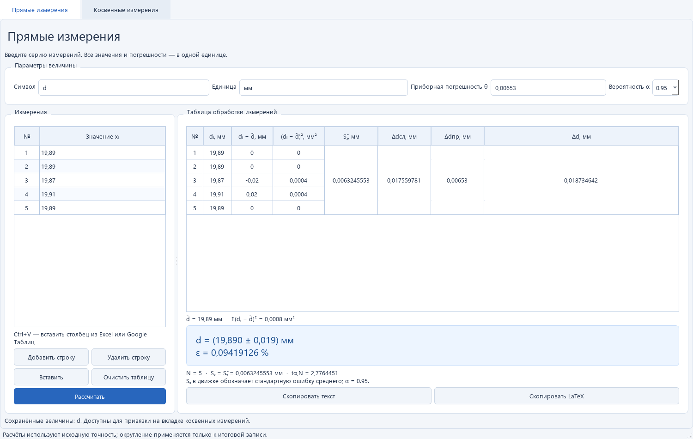
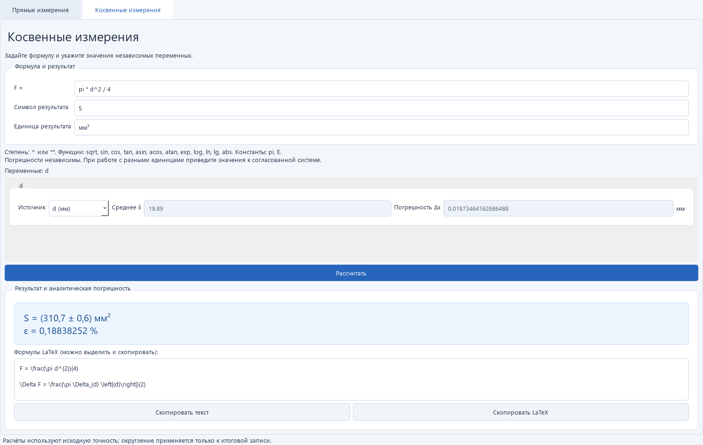

# Обработка лабораторного эксперимента

Приложение Python 3.11+ / PySide6 для прямых и косвенных измерений.

## Быстрый старт: готовая программа

Для Windows 10/11 x64 скачайте `ExperimentProcessor.exe` из раздела
[Releases](../../releases/latest) этого репозитория и откройте файл двойным щелчком.
Установка Python и библиотек не требуется. При первом запуске распаковка во временную папку
может занять некоторое время.

Введите измерения в таблицу и нажмите «Рассчитать». Для расчёта по формуле перейдите
на вкладку косвенных измерений и выберите сохранённую величину или введите данные вручную.

## Основные экраны

Прямые измерения: серия наблюдений, таблица отклонений, погрешности и итоговая запись
с копированием текста или LaTeX.



Косвенные измерения: формула, связанные исходные величины и аналитическое распространение
погрешности. В примере используется результат прямого измерения диаметра.



## Запуск в Windows

```powershell
python -m venv .venv
.venv\Scripts\python.exe -m pip install -r requirements.txt
.venv\Scripts\python.exe app.py
```

`gui_app.py` также запускает приложение.

## Локальная сборка EXE

Используйте Windows x64 и Python 3.11 x64. После создания окружения и установки
зависимостей, как описано выше, установите сборщик:

```powershell
.venv\Scripts\python.exe -m pip install pyinstaller pytest
```

Сборка одной командой из корня проекта:

```powershell
.venv\Scripts\python.exe build_exe.py
```

Результат: `dist/ExperimentProcessor.exe`. Скрипт удаляет прежние `build/` и `dist/`,
собирает приложение в режиме `--onefile --noconsole`, подключает Qt-плагины
`platforms` и доступные `styles`, нативные библиотеки NumPy/SciPy и скрытые импорты
SciPy/SymPy. Если существует `assets/icon.ico`, он используется как иконка EXE.
Неиспользуемые Tkinter, Matplotlib, IPython, pytest и альтернативные Qt-привязки исключены.
UPX отключён для совместимости нативных библиотек; отсутствие ложных срабатываний
антивирусов не гарантируется.

## Работа с интерфейсом

- На вкладке прямых измерений задайте символ, единицу, приборную погрешность и доверительную вероятность. Введите значения или скопируйте один столбец чисел без заголовка и нажмите Ctrl+V в таблице. Запятая, точка и научная запись поддерживаются. Пустые строки нужно заполнить или удалить.
- После расчёта справа появится таблица отклонений с объединёнными ячейками общих погрешностей, среднее, сумма квадратов и округлённая итоговая запись. Кнопки копируют текст или LaTeX.
- Каждый расчёт сохраняется в памяти под символом величины. Для следующей величины измените символ и данные; повторный расчёт того же символа обновляет сохранённый результат. Изменение исходных полей скрывает текущий вывод, но сохранённые результаты остаются доступны до закрытия приложения.
- На вкладке косвенных измерений введите формулу, например `m * v^2 / 2`. Поля переменных появляются автоматически. Выберите сохранённую величину в списке источников или введите среднее и абсолютную погрешность вручную. По умолчанию сохранённые среднее и погрешность округляются как в итоговой карточке; снимите флажок округления для расчёта с исходной точностью. Ручной ввод используется без изменений.
- Успешные косвенные расчёты тоже сохраняются в общем пуле: результат `V = S/t` можно выбрать источником для следующей формулы `V^2/2`. При совпадении символов используется последний успешный результат. Пул хранится до закрытия приложения; сохранённые результаты являются снимками и не пересчитываются автоматически при изменении исходных величин. Связанные поля обновляются при новом расчёте выбранного источника. Цепочки используют приближение независимых погрешностей; зависимости между величинами из общего исходного измерения не учитываются.
- Кнопка «Показать ход расчёта / формулы подстановки» открывает численную подстановку в исходную формулу, частные производные, их значения и вклады в абсолютную погрешность. Блок изначально скрыт; текст можно выделить и скопировать.
- Единицы не преобразуются автоматически. Используйте согласованные единицы; погрешности считаются независимыми. Тригонометрические функции принимают радианы.
- Ошибки вычисления показывают понятное сообщение, разворачиваемые технические детали и кнопку копирования отчёта с исходными данными.

Вычисления и разбор формулы выполняются в фоне. Промежуточные данные показываются с восемью значащими цифрами, итог округляется по правилам `calc_engine.round_measurement`. Нулевая приборная погрешность разрешена движком. Поля `std_dev` и `std_error` существующего движка оба содержат стандартную ошибку среднего; интерфейс указывает это явно.

## Проверка

```powershell
.venv\Scripts\python.exe -m pip install pytest
.venv\Scripts\python.exe -m pytest -q
```

GUI-тесты используют платформу Qt `offscreen` и не открывают окон на рабочем столе.
